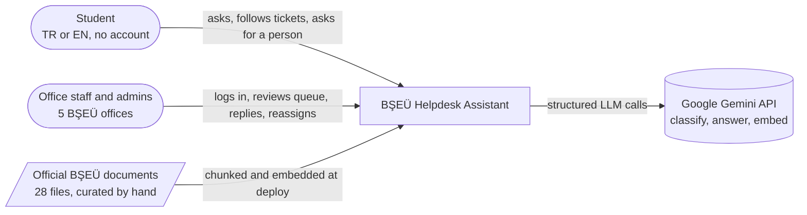
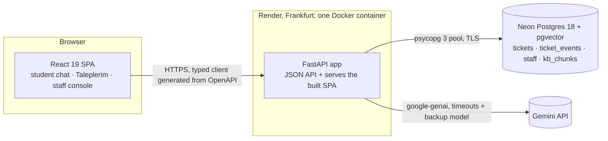
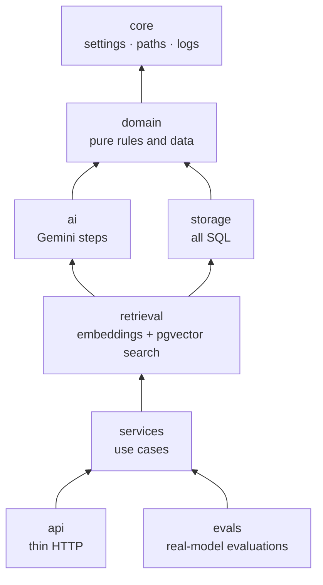
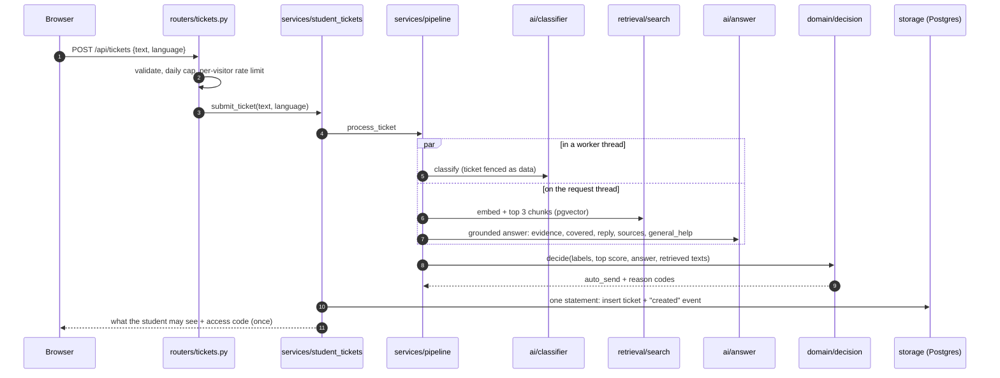
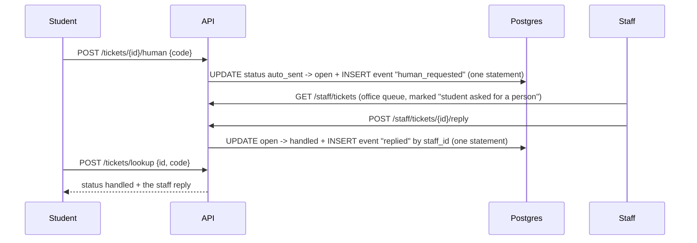
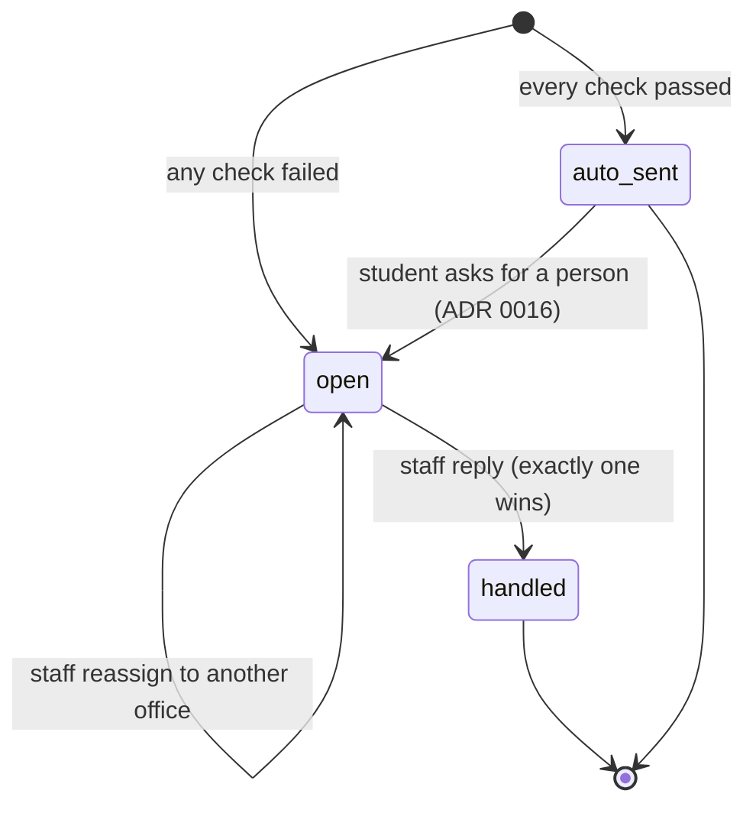
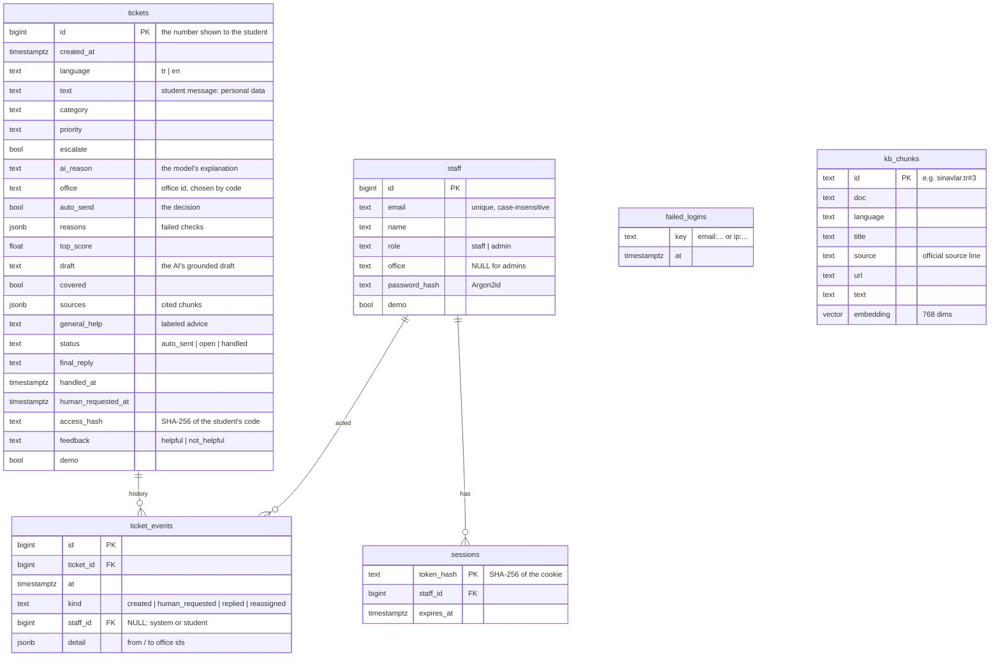

# Architecture

How the BŞEÜ helpdesk assistant is built and why. Written for engineers, reviewers and coding agents.
The product overview is in [README.md](README.md) (Turkish: [README.tr.md](README.tr.md)); the
reasons behind each major choice are in [docs/decisions/](docs/decisions/) (ADRs, in Turkish).

Describes `main` as of 2026-11-14: database schema version 6, 17 ADRs.

**Contents:** 1 [Goals](#1-goals-and-constraints) · 2 [Context](#2-system-context) ·
3 [Containers](#3-containers-and-deployment) · 4 [Layers](#4-code-layers) ·
5 [Use cases](#5-use-cases) · 6 [Flows](#6-key-flows) · 7 [Decision](#7-the-decision-is-code-not-ai) ·
8 [Lifecycle](#8-ticket-lifecycle) · 9 [Data](#9-data-model) · 10 [Security](#10-security-and-privacy) ·
11 [Quality](#11-quality-system) · 12 [Invariants](#12-invariants) · 13 [Limits](#13-known-limits-and-the-way-to-production)

## 1. Goals and constraints

| Goal | What it means here |
|---|---|
| **Safe answers** | Nothing reaches a student unless deterministic code has checked it against official documents. Sensitive tickets always go to a person. |
| **Honest measurement** | Every metric has its sample size and a 95% interval; two locked test sets are never used for tuning. |
| **Privacy (KVKK)** | Student text never reaches logs; secrets and access codes are stored only as hashes. |
| **Explainable** | One maintainer must be able to explain every line; complexity must pay for itself. |

Constraints: free tiers (Render web service, Neon Postgres, Gemini API rate limits), a single
container, Turkish and English everywhere a student reads.

## 2. System context

## 3. Containers and deployment

One deployable unit on purpose: one maintainer gains nothing from separate services, and the free
tier runs one container (ADR 0004, 0005). Locally `docker compose up` runs the same image next to a
Postgres container. CI must pass before Render deploys. The SPA's API client is generated from the
backend's OpenAPI schema, and CI fails if the two drift.

## 4. Code layers

The backend is the installable package `src/helpdesk/`. A layer imports only layers below it, and
[`tests/test_architecture.py`](tests/test_architecture.py) parses every import and fails CI otherwise.

| Layer | Modules | Rule |
|---|---|---|
| `core` | `settings.py` (the only environment reads, validated at startup), `paths.py`, `logs.py` | no helpdesk imports |
| `domain` | `decision.py` (auto-send rules), `grounding.py`, `offices.py`, `tickets.py` (labels, datasets), `outputs.py` (LLM output schemas), `records.py` (saved ticket, history event), `knowledge.py` (`Chunk`), `staff.py` | pure: no I/O, no model, no database |
| `ai` | `provider.py` (`LLMProvider` protocol), `gemini.py`, `classifier.py`, `answer.py`, `fence.py` | talks to the model only through `LLMProvider` |
| `storage` | `db.py` (pool, append-only migrations), `tickets.py`, `staff.py` | the **only** place with SQL |
| `retrieval` | `knowledge_base.py`, `embeddings.py`, `search.py` | index sync and nearest-neighbour search |
| `services` | `pipeline.py`, `student_tickets.py`, `staff_desk.py`, `auth.py`, `insights.py`, `errors.py` | the use cases; raise `NotFound` / `Conflict` / `AssistantUnavailable`, never HTTP errors |
| `api` | `app.py` (factory, maps service errors to 404/409/503), `deps.py`, `security.py`, `routers/` | input shapes, rate limits, one call into a use case |
| `evals` | `classifier.py`, `retrieval.py`, `pipeline.py`, `security.py`, `stats.py`, `report.py` | real model calls, versioned results in `eval/` |

`api/app.py` and `api/deps.py` are the **composition root**: they build the real Gemini client, the
connection pool and the search index and hand them in. Everything else receives its collaborators as
arguments, so each test builds its own app with a fake pipeline and its own database schema.

## 5. Use cases

| Actor | Use case | Service function | Endpoint |
|---|---|---|---|
| Student | Ask a question | `student_tickets.submit_ticket` | `POST /api/tickets` |
| Student | Follow a ticket (Taleplerim) | `student_tickets.lookup` | `POST /api/tickets/lookup` |
| Student | Ask for a person after an automatic answer | `student_tickets.ask_for_a_person` | `POST /api/tickets/{id}/human` |
| Student | Rate an answer | `student_tickets.give_feedback` | `POST /api/tickets/{id}/feedback` |
| Staff | Log in / out, try the demo | `auth.authenticate`, `auth.create_session`, `staff_desk.start_demo` | `/api/auth/*` |
| Staff | Work the office queue | `staff_desk.queue` | `GET /api/staff/tickets` |
| Staff | Read a ticket and its history | `staff_desk.visible_ticket`, `staff_desk.history` | `GET /api/staff/tickets/{id}[/history]` |
| Staff | Reply and close | `staff_desk.reply` | `POST /api/staff/tickets/{id}/reply` |
| Staff | Move to another office | `staff_desk.reassign` | `PATCH /api/staff/tickets/{id}` |
| Staff | See statistics | `staff_desk.insights` | `GET /api/staff/insights` |
| Admin | Everything staff do, for every office | same functions; `office_scope` is `None` | same |
| Maintainer | Add a staff account | `auth.create_staff` | `tools/add_staff.py` (no public sign-up) |

Students have no account: each ticket gets a random 128-bit code, shown once, and only its hash is
stored (ADR 0009). Staff see only their office's tickets; a ticket from another office answers 404,
exactly like a missing one (`staff_desk.visible_ticket`).

## 6. Key flows

### Submit a ticket

The classifier does not need the answer and the answer does not need the labels, so the student waits
for the slower of the two model calls, not for both. A failing model call is retried, then sent to a
backup model (ADR 0014, 0015); if the pipeline still fails, the student gets a 503 and the log gets
only the error type.

### Ask for a person, then a staff reply

## 7. The decision is code, not AI

A reply is sent automatically only if every check passes; each failing check adds a reason code that
staff and the student's "Nasıl karar verildi?" trace both show (`domain/decision.py`, ADR 0002).

| Check | Reason code when it fails |
|---|---|
| category is not `other` | `category_other` |
| the model did not ask to escalate | `escalation` |
| priority is not `urgent` | `urgent` |
| best retrieval score ≥ `MIN_SCORE` (0.65) | `weak_match` |
| the documents answer the main question | `not_covered` |
| the reply cites only retrieved rules (at least one) | `no_citation` |
| the quoted evidence appears in a retrieved rule | `ungrounded` (ADR 0010) |

What a forwarded ticket may still show the student:

| Shown | When | ADR |
|---|---|---|
| **First help**: the cited part of the draft | not escalated, cited, grounded, strong match | 0008 |
| **General help**: labeled practical advice, no BŞEÜ-specific facts | not escalated, no planted rule | 0013 |
| Nothing from the AI, a person answers | escalated (crisis, harassment, hacked account, appeals...) | 0008 |

## 8. Ticket lifecycle

`auto_send` records what the system decided; `status` records where the ticket is now. They differ only
when a student sent an automatic answer on to a person, which keeps evaluations of the decision honest.
Every transition is written with its `ticket_events` row in the same SQL statement (ADR 0017).

## 9. Data model

- **Migrations** are append-only steps in `storage/db.py::MIGRATIONS`, applied at startup under an
  advisory lock (safe with several instances starting at once); each has an upgrade test from the
  previous version.
- **History** (`ticket_events`) is append-only: a trigger refuses every UPDATE; rows go away only with
  their ticket (the demo reset).
- **Search index:** `kb_chunks` is rebuilt from `data/kb_index.json` when the knowledge base changes;
  exact scan, no ANN index (about 190 rows: fast and never misses).

## 10. Security and privacy

| Threat | Defence | Where |
|---|---|---|
| Prompt injection in the ticket | ticket fenced as data; evidence must appear in retrieved text | `ai/fence.py`, `domain/grounding.py`, ADR 0010 |
| Cost abuse of the paid model | per-visitor limits + a system-wide daily cap, checked before any model call | `api/security.py`, `routers/tickets.py`, `student_tickets.daily_cap_reached` |
| Spoofed client IP | only the trusted proxy header is read | ADR 0007 |
| Staff account takeover | Argon2id, lockout per account and per address, one message for every failure, HttpOnly + Secure + SameSite cookie | `services/auth.py` |
| CSRF | same-origin check on every changing route | `api/security.py::same_origin` |
| Cross-office access | one access rule; another office's ticket looks missing | `services/staff_desk.py::visible_ticket` |
| Personal data in logs | only ids, lengths, codes and error types are logged | `services/`, `core/logs.py` |
| Student ticket access | random 128-bit code shown once, only its hash stored; same 404 for a wrong code and an unknown number | ADR 0009 |
| Tampering with history | append-only `ticket_events`, enforced by a database trigger | ADR 0017 |
| Secrets | environment only; the secrets file is git- and docker-ignored; agent hooks block it | `core/settings.py`, `.claude/` |

## 11. Quality system

- **CI** (`.github/workflows/ci.yml`): ruff, mypy strict, pytest on a real pgvector Postgres with a
  coverage gate, the layer test, OpenAPI drift; frontend Biome, TypeScript, build, Playwright on
  desktop and phone; Docker build. CodeQL and Dependabot weekly.
- **Tests** fake every model call (`tests/fakes.py`); each test gets its own Postgres schema; every
  rule and every bug fix gets a test written first.
- **Evals** (`src/helpdesk/evals/`, `make eval SUITE=...`) make real calls and save versioned JSON in
  `eval/` (git commit, prompt, dataset and knowledge-base hashes, model) with Wilson 95% intervals.
- **Records:** every decision has an ADR; every change has a changelog entry
  ([docs/changelog.md](docs/changelog.md)); releases are summarised in [CHANGELOG.md](CHANGELOG.md).

## 12. Invariants

A change that breaks one of these needs a new ADR.

1. The auto-send decision is deterministic code with a test for every rule.
2. An escalated ticket is never auto-sent and never shows the student AI text.
3. Locked test sets are never edited and never used to tune prompts.
4. Student text never reaches logs; tokens and codes are stored only as hashes.
5. Every metric in the README has its sample size and interval, and comes from a saved file in `eval/`.
6. Database migrations are append-only; released steps are never edited.
7. A layer imports only the layers below it; SQL lives only in `storage/`.
8. Every change to a ticket is recorded in `ticket_events`, in the same statement as the change.

## 13. Known limits and the way to production

| Today (demo-grade) | Production-grade |
|---|---|
| Rate-limit counters live in process memory (correct for one instance) | shared counters in Postgres or Redis (roadmap phase E) |
| Students have no login; a ticket is reachable from one browser via its code | university SSO and e-mail notifications |
| One category per ticket | split multi-issue tickets, or route to several offices |
| Knowledge base updated by hand | an owner per document, review dates, change alerts |
| Cost and latency are logged per call, not yet stored | an `llm_calls` table and a cost panel (roadmap phase D) |
| Free hosting sleeps after 15 minutes | a paid instance with health-based restarts |
