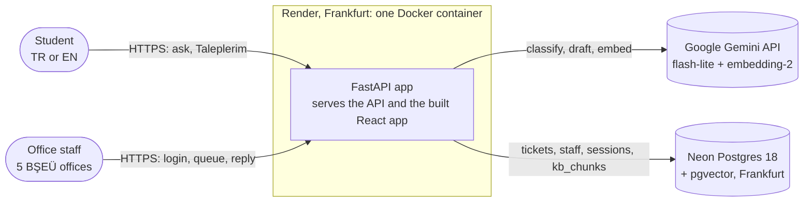
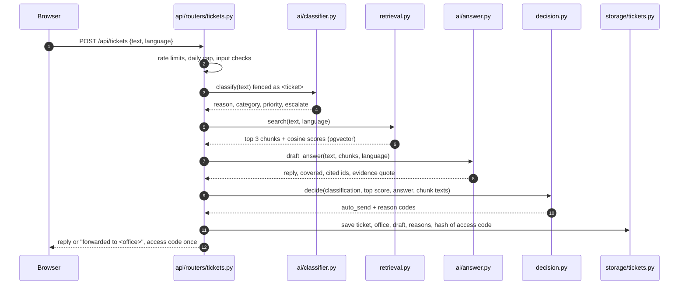
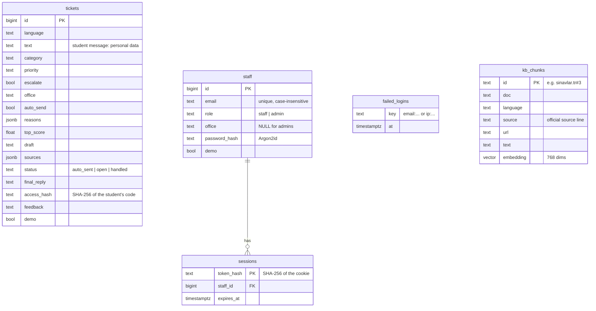

# Architecture

How the BŞEÜ helpdesk assistant is built, why, and where it is going. Written for engineers and coding
agents; the Turkish README and the ADRs in `docs/decisions/` are written for the course.

Status: describes the code on `main` as of 2026-10-24 (schema version 3). The target layout at the end is
the plan for upgrade Phase B (`docs/ROADMAP.md`).

## 1. System context



One deployable unit on purpose: a student project with one maintainer gains nothing from separate
services, and the free hosting tier runs one container. Locally, `docker compose up` runs the same image
next to a Postgres container (ADR 0004, 0005).

## 2. The pipeline: one ticket, end to end

`src/helpdesk/pipeline.py::process_ticket` is a plain function of four steps. LangGraph was considered and not
used: a straight line of steps needs no graph (PROJECT_BRIEF, "Later phases").



| Step | Module | Model call | Output |
|---|---|---|---|
| Classify | `ai/classifier.py` | Gemini, structured output, thinking `high` | `reason` first, then category (7), priority (4), escalate |
| Retrieve | `retrieval.py`, `knowledge_base.py` | embedding of the ticket | top 3 of 112 chunks from 22 documents (11 topics x TR/EN), exact scan |
| Draft | `ai/answer.py` | Gemini, structured output | reply, `covered`, cited rule ids, word-for-word `evidence` |
| Decide | `decision.py` | none: plain code (ADR 0002) | `auto_send` and the reason codes |

## 3. The decision is code, not AI

A reply is sent automatically only if ALL checks pass; each failing check adds a reason code that staff
and the student's "Nasıl karar verildi?" trace both show.

| Check | Reason code when it fails |
|---|---|
| category is not `other` | `category_other` |
| the model did not ask to escalate | `escalation` |
| priority is not `urgent` | `urgent` |
| best retrieval score >= `MIN_SCORE` (0.65) | `weak_match` |
| the documents answer the ticket | `not_covered` |
| the reply cites only retrieved rules (at least one) | `no_citation` |
| the cited evidence appears word for word in that rule | `ungrounded` (ADR 0010) |

Forwarded tickets may still show the student the grounded part of the draft as "first help", never on
escalated, uncited, ungrounded or weak-match tickets (ADR 0008).

## 4. Data model



Migrations are append-only steps in `store.MIGRATIONS`, applied at startup under an advisory lock.
`kb_chunks` is rebuilt from `data/kb_index.json` when the knowledge base changes.

## 5. Security and privacy

| Threat | Defence | Where |
|---|---|---|
| Prompt injection in the ticket | ticket fenced in `<ticket>` tags; evidence must match retrieved text word for word | `fence.py`, `grounding.py`, ADR 0010 |
| Cost abuse of the paid model | per-visitor limits + a daily cap on new tickets | `api/security.py` `RateLimiter`, `routers/tickets.py::check_ticket_limits` |
| Spoofed client IP | only the trusted proxy header (`CF-Connecting-IP`) | ADR 0007 |
| Staff account takeover | Argon2id, login rate limit, one message for every failure, HttpOnly + Secure + SameSite cookie | `auth.py` |
| CSRF | same-origin check on every changing route | `api/security.py::same_origin` |
| Cross-office access | every staff read checks the office | `api/routers/staff.py::visible` |
| Personal data in logs | only ids, lengths, codes and error types are logged | `api/routers/`, `core/logs.py` |
| Student ticket lookup | random 128-bit code shown once; only its hash stored | ADR 0009 |
| Secrets | environment only; `.env` git- and docker-ignored; agent hooks block it | `core/settings.py`, `.claude/` |

Known limits: rate-limit counters live in process memory (correct for the single free-tier instance,
wrong with several workers); upgrade Phase E moves them to Postgres.

## 6. Quality system

- **CI** (`.github/workflows/ci.yml`): ruff, mypy strict, pytest on a real pgvector Postgres with a
  coverage gate, OpenAPI drift check; frontend Biome, TypeScript, generated-client drift, build,
  Playwright on desktop and phone; Docker build. **CodeQL** weekly and on every PR; **Dependabot** weekly.
- **Tests** fake every Gemini call (`tests/fakes.py`); each test gets its own Postgres schema.
- **Evals** (`src/helpdesk/evals/`) make real calls and save JSON in `eval/` with Wilson 95% intervals. Two
  locked sets are never used for tuning (ADR 0003); an agent hook blocks edits to them.

## 7. Invariants (a change that breaks one needs an ADR)

1. The auto-send decision is deterministic code with a test for every rule.
2. An escalated ticket is never auto-sent and never gets first help.
3. Locked test sets are never edited and never used to tune prompts.
4. Student text never reaches the logs; tokens and codes are stored only as hashes.
5. Every metric in the README has its sample size and interval, and comes from a saved file in `eval/`.
6. Database migrations are append-only.

## 8. Package layout (upgrade Phase B, ADR 0012)

The backend is the installable package `src/helpdesk/`. Layers only depend inward:
core <- domain <- ai, retrieval, storage <- pipeline, auth, insights <- api, evals.

```text
src/helpdesk/
  core/        settings.py (AppSettings, GeminiSettings: the only environment reads),
               paths.py, logs.py
  domain/      tickets.py (labels, dataset), offices.py, decision.py, grounding.py,
               outputs.py (the model's output schemas)            <- pure, no I/O to model or DB
  ai/          provider.py (LLMProvider protocol), gemini.py (GeminiProvider), classifier.py,
               answer.py, fence.py
  retrieval/   knowledge_base.py, embeddings.py, search.py
  storage/     db.py (connections, pool, migrations), tickets.py (the ticket table)
  api/         app.py (create_app factory), deps.py (Services, dependencies), security.py,
               routers/ (tickets, login, staff, web)
  evals/       stats.py, classifier.py, retrieval.py, pipeline.py, security.py
  auth.py, insights.py, pipeline.py, panel.py (old Streamlit page)
```

Why: the app factory and dependency injection removed the module globals that tests used to
monkeypatch (each test builds its own app); one settings module makes a bad value fail at startup;
the `LLMProvider` protocol lets the model comparison (roadmap item 9) swap models without touching
prompts or steps. Behaviour was kept identical: the API schema and the Gemini requests are
byte-identical to the flat version. Not done (yet): a `helpdesk` CLI and versioned prompt files
(Phase C), separate staff repository module.
