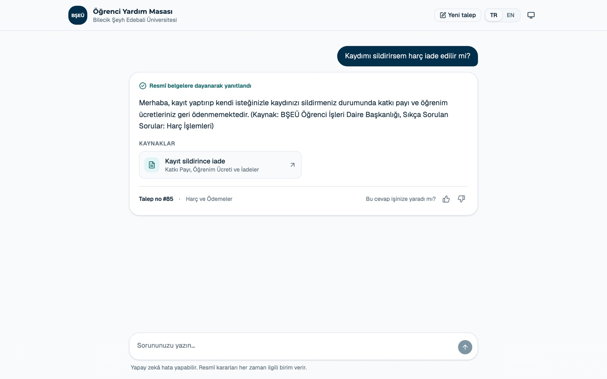
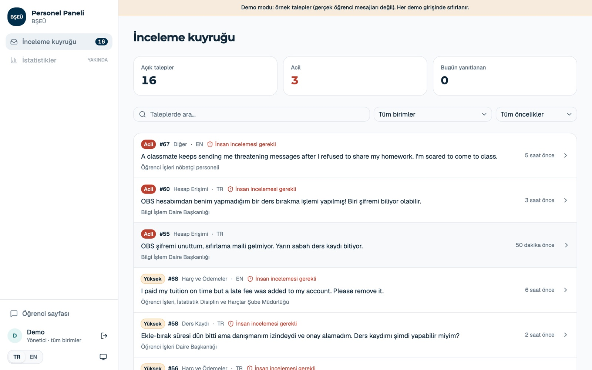
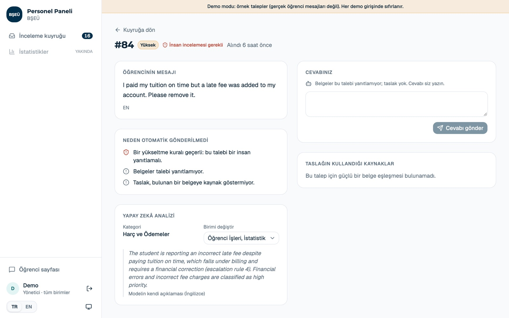
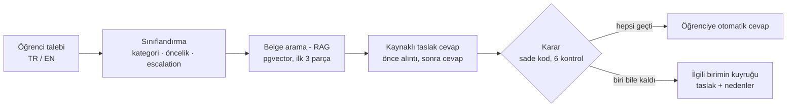

# Üniversite Yardım Masası Ticket Asistanı

[](https://github.com/AhmedElghazzawy/ai-ticket-assistant/actions/workflows/ci.yml)

**Çalışma Tasarımı I** · Bilecik Şeyh Edebali Üniversitesi (BŞEÜ), Bilgisayar Mühendisliği

Öğrencilerin yardım masasına yazdığı talepleri (ticket) okuyan bir AI asistanı. Sistem talebi etiketler (kategori, öncelik, escalation), üniversitenin resmî belgelerinde cevabı arar (RAG), kaynağını gösteren bir cevap yazar ve karar verir: cevabı otomatik göndermek mi, yoksa taslakla birlikte doğru birime (bir insana) yönlendirmek mi.

**Canlı demo:** https://bseu-helpdesk.onrender.com (ücretsiz sunucu: 15 dakika ziyaretçi olmazsa uyur, ilk açılış yaklaşık 1 dakika sürebilir)

## Hocam, nereden başlamalı?

| Ne görmek istiyorsanız | Nerede |
|---|---|
| Sistemi denemek (öğrenci tarafı) | Canlı demo → bir soru yazın, ör. "Kaydımı sildirirsem harç iade edilir mi?" |
| Personel panelini denemek | Canlı demo → `/staff` → **Demo olarak dene** (hesap gerekmez, yalnızca örnek talepler) |
| Kategoriler, birimler, escalation kuralları | [Kategoriler ve birimler](#kategoriler-ve-birimler-7-kategori) · tam kural kitabı: [`docs/labels.md`](docs/labels.md) |
| Veri seti | [Veri seti](#veri-seti) · [`data/tickets/`](data/tickets/) |
| Değerlendirme yöntemi ve sonuçlar | [Sonuçlar özeti](#sonuçlar-özeti) · ayrıntılar aşağıda · ham sonuçlar: [`eval/`](eval/) |
| Kapsam ve sınırlar | [Kapsam ve sınırlar](#kapsam-ve-sınırlar-v1) |
| Her değişiklik ve nedeni | [Sürümler (Releases)](https://github.com/AhmedElghazzawy/ai-ticket-assistant/releases) · ayrıntılı çalışma notları: [`docs/changelog.md`](docs/changelog.md) (İngilizce) |

## Ekran görüntüleri

| Öğrenci: kaynaklı otomatik cevap | Personel: inceleme kuyruğu |
|---|---|
|  |  |

Personel: yönlendirilen bir talep (neden otomatik gönderilmediği ve yapay zekânın açıklaması):



## Akış (pipeline)



Sınıflandırma ve cevap yazma Gemini (LLM) ile yapılır; **karar** ise yapay zekâ değil, test edilen sade koddur ([`src/decision.py`](src/decision.py)).

| Aşama | Durum |
|---|---|
| Sınıflandırma ve değerlendirme | ✅ Phase 1 |
| Kilitli test seti (güvenilir skor) | ✅ Phase 2 |
| Belge arama (RAG retrieval) | ✅ Phase 3 |
| Kaynaklı cevap, gönder / gönderme kararı, birime yönlendirme | ✅ Phase 4 |
| API (FastAPI) ve otomatik testler (pytest) | ✅ Phase 5 |
| İnsan inceleme kuyruğu | ✅ Phase 6 |
| Altyapı: CI, tip kontrolü, Docker, yapılandırılmış loglar, yeni web arayüzü (React) | ✅ Phase 7 |
| Personel girişi, demo modu, kötüye kullanım koruması (rate limit) | ✅ |
| Postgres + pgvector (talepler ve belge arama) | ✅ Phase 10 |
| Canlı demo (Render + Neon) | ✅ |
| Daha gerçekçi veri (uzun, yazım hatalı, karışık dilli talepler) | 🔄 Phase 8, devam ediyor |
| Güven aralıkları, model karşılaştırması, hibrit arama, güvenlik testleri | ⏳ sırada |

## Sonuçlar özeti

Kilitli test seti: prompt'u ayarlamak için hiç kullanılmayan 40 talep (20 TR + 20 EN). Parantez içinde %95 güven aralığı (Wilson): örnek küçük olduğu için aralıklar geniştir.

| Ölçüt | Sonuç | Örnek sayısı |
|---|---|---|
| Üç etiketin üçü de doğru | %73,8 (yaklaşık %60–86) | 40 talep, 2 çalıştırma |
| **Kaçırılan escalation** (en tehlikeli hata) | **0** (gerçek oran %0–21 arasında olabilir) | 14 escalation talebi |
| Doğru belge ilk 3 sonuçta (hit@3) | %100 (%82–100) | cevaplanabilir 17 talep |
| Hatalı otomatik gönderim | 1 (zararsız; boşluk sonradan kapatıldı) | 40 talep |

Dürüst not: talepleri ben yazdım ve etiketledim (sentetik veri); gerçek öğrenci mesajları daha uzun ve dağınıktır. Bu yüzden Phase 8'de veri zenginleştiriliyor. Ayrıntılar ve "bu skor neyi kanıtlamaz" bölümü aşağıda.

## Kategoriler ve birimler (7 kategori)

| Kategori | Kapsam (örnekler) | Yönlendirilen BŞEÜ birimi |
|---|---|---|
| `account_access` (Hesap Erişimi) | OBS / SOFRA / e-posta girişi, şifre, 2FA, ele geçirilmiş hesap | Bilgi İşlem Daire Başkanlığı |
| `it_support` (Teknik Destek) | Wi-Fi / eduroam, UZEM, yazıcı, laboratuvar yazılımı (giriş sorunu olmadan) | Bilgi İşlem Daire Başkanlığı |
| `registration` (Ders Kaydı) | Ekle-bırak, kontenjan, ön koşul, ders çakışması, AKTS sınırı | Öğrenci İşleri Daire Başkanlığı |
| `academic_records` (Akademik Kayıtlar) | Transkript, öğrenci belgesi, notlar, kayıt dondurma, muafiyet, staj evrakları, disiplin, mezuniyet | Öğrenci İşleri Daire Başkanlığı |
| `billing` (Ödemeler) | Harç / katkı payı, üniversite bursu, iade, harç muafiyeti | Öğrenci İşleri, İstatistik Disiplin ve Harçlar Şube Müdürlüğü |
| `campus_life` (Kampüs Yaşamı) | Yemekhane, kulüpler, ulaşım, psikolojik danışmanlık, kütüphane, KYK yurt yönlendirmesi | Sağlık, Kültür ve Spor (SKS) Daire Başkanlığı |
| `other` (Diğer) | Kayıp eşya, kariyer, KYK burs/kredi, tehdit ve taciz, konu dışı veya anlaşılmayan ticket'lar | Öğrenci İşleri nöbetçi personeli |

**Öncelik (priority):** `urgent`, `high`, `medium`, `low`. Öncelik = sorunun öğrenciyi ne kadar engellediği × ne kadar acil olduğu.

**Escalation (insana yönlendirme):** şu durumlardan herhangi biri varsa: güvenlik tehdidi, taciz veya kriz belirtisi; ele geçirilmiş olabilecek hesap; kural istisnası; para veya resmi kayıt hatası (iade/düzeltme); not veya sınav itirazı ya da sınavın geçerliliği hakkında karar; hukuki tehdit, disiplin süreci veya cevapsız tekrarlanan başvuru. Sadece sinirli olmak escalation sebebi değildir.

Tüm kurallar ve sınır durumları: [`docs/labels.md`](docs/labels.md). Araştırmaya dayalı sorun listesi: [`docs/problem_catalog.md`](docs/problem_catalog.md).

## Veri seti

- **80 geliştirme (dev) ticket'ı:** 40 Türkçe + 40 İngilizce, [`data/tickets/tickets.jsonl`](data/tickets/tickets.jsonl) (her satır bir JSON: `id`, `text`, `language`, `category`, `priority`, `escalate`).
- Her kategoride 10-12 ticket; dört öncelik seviyesi de var; ticket'ların %26'sı escalation gerektiriyor.
- Zor durumlar bilerek eklendi: iki sorunlu ticket'lar, çok kısa ("help", "obs calismiyor"), Türkçe karakter olmadan yazım, karışık dil, sinirli ama basit, kibar ama ciddi, gizli kriz belirtisi, prompt injection.
- Ticket'lar gerçek BŞEÜ sistem adlarını kullanır: OBS, SOFRA, UZEM, @ogrenci.bilecik.edu.tr, Akıllı Kart.
- **Kilitli test seti (Phase 2):** 40 ticket (20 TR + 20 EN), [`data/tickets/test_tickets.jsonl`](data/tickets/test_tickets.jsonl): prompt'u ayarlamak için asla kullanılmaz, sadece son skor için.

## Sınıflandırma yöntemi

- Model: `gemini-3.5-flash-lite` (Google Gemini API, ücretsiz katman). Model adı `.env` dosyasında, kod değişmeden değiştirilebilir.
- **System prompt = kural kitabı:** [`docs/labels.md`](docs/labels.md) olduğu gibi prompt'a eklenir. Tek bir doğruluk kaynağı.
- **Structured output:** model sadece bizim JSON şemamıza uyan bir cevap verebilir (geçersiz kategori imkânsız).
- **`reason` alanı önce:** model önce gerekçesini yazar, sonra etiketleri seçer.
- **Temperature 1.0 (varsayılan):** Google'ın resmi Gemini 3 önerisi; daha düşük değerler döngü veya performans kaybına yol açabilir.
- **Thinking level `high`:** `low` ile karşılaştırıldı ve daha iyi çıktı (aşağıda).

## Değerlendirme yöntemi

[`src/evaluate.py`](src/evaluate.py) her ticket'ı **iki kez** sınıflandırır ve modelin etiketlerini bizim etiketlerimizle karşılaştırır:

- Her etiket için doğruluk (accuracy), üçü birden doğru, Türkçe ve İngilizce ayrı ayrı
- **Kaçırılan escalation:** insana gitmesi gerekip gitmeyen ticket (en tehlikeli hata)
- Gereksiz escalation (güvenli hata)
- Öncelik için "bir seviye yakın" doğruluk (öncelik öznel bir etikettir)
- **Tutarlılık (consistency):** aynı model aynı ticket'a ikinci çalıştırmada aynı etiketi veriyor mu?

Sonuçlar `eval/results_low.json` ve `eval/results_high.json` dosyalarına kaydedilir.

## İlk sonuçlar (80 dev ticket, 2 çalıştırmanın ortalaması)

| Ölçüt | thinking `low` | thinking `high` |
|---|---|---|
| Kategori | %98,1 | %98,1 |
| Öncelik (tam) | %75,6 | **%88,1** |
| Öncelik (bir seviye yakın) | %98,8 | %98,8 |
| Escalation | %94,4 | **%96,2** |
| Üçü de doğru | %70,6 | **%84,4** |
| **Kaçırılan escalation** | **0** | **0** |
| Tutarlılık (kategori / öncelik / escalation) | %99 / %89 / %96 | %99 / %96 / %98 |

`high`, 1. çalıştırma, dile göre (üçü de doğru): Türkçe %75,0, İngilizce %92,5.

### Bu skor neyi kanıtlamaz (önemli)

- **İyimser bir skordur.** Kural kitabı bu 80 ticket'a bakılarak netleştirildi ve `high` de bu ticket'larda seçildi. Güvenilir skor Phase 2'deki **kilitli test setinden** gelecek.
- **Rastgelelik var:** aynı model aynı ticket'larda iki çalıştırmada %73,8 ve %67,5 aldı (`low`, üçü de doğru). Tek bir skor kesin değildir.
- **Etiketler tartışmalı olabilir:** özellikle öncelik. Ticket'ları ve etiketleri biz yazdık; gerçek öğrenci ticket'ları daha dağınıktır.
- **Türkçe ticket'lar daha zor:** Türkçe skorlar İngilizceden düşük.

## Güvenilir skor: kilitli test seti (Phase 2)

40 yeni ticket (20 TR + 20 EN), prompt'u ayarlamak için hiç kullanılmadı. 2 çalıştırmanın ortalaması:

| Ölçüt | Dev (80) | **Test (40)** |
|---|---|---|
| Kategori | %98,1 | **%90,0** |
| Öncelik (tam) | %88,1 | **%85,0** |
| Escalation | %96,2 | **%88,8** |
| Üçü de doğru | %84,4 | **%73,8** |
| **Kaçırılan escalation** | 0 | **0** |

Dev skoru yaklaşık 10 puan iyimserdi. Kaçırılan escalation testte de 0: kural kitabında olmayan durumlar (oturma izni, gıda zehirlenmesi, intihardan bahseden bir arkadaş) bile insana yönlendirildi. Not: test ticket'larını araştırmaya dayanarak Claude taslak olarak yazdı; sınıf arkadaşlarından toplanan gerçek ticket'lar daha güçlü bir test olur.

## Bilgi tabanı ve belge arama (Phase 3)

- 11 konu × 2 dil = 22 belge, yalnızca resmî BŞEÜ kaynaklarından: Ön Lisans ve Lisans Eğitim-Öğretim Yönetmeliği (Resmî Gazete 07.07.2019), Muafiyet ve İntibak Yönergesi, Yaz Okulu Yönetmeliği, Mühendislik Fakültesi Staj Yönergesi, Öğrenci Kulüpleri Yönergesi, Öğrenci İşleri SSS, 2025-2026 Oryantasyon Sunumu (SOFRA, e-posta, OBS, UZEM, eduroam, kütüphane, yemekhane kartı). Tırnak içindeki 59 cümlenin 59'u resmî metinle birebir kontrol edildi.
- Her `##` bölümü bir parça (chunk): 112 parça. Embedding: `gemini-embedding-2` (768 boyut, çok dilli). Ticket hangi dildeyse o dilde aranır.
- Arama Postgres içinde, pgvector ile yapılır (`kb_chunks` tablosu, cosine distance `<=>`). Vektörler bir kez hesaplanıp `data/kb_index.json` dosyasında saklanır (git'te sürümlü); uygulama başlarken tabloya kopyalanır, böylece boş bir veritabanı (ör. Neon) API çağrısı yapmadan dolar. Vektör index'i (HNSW) bilerek yok: ~100 parça için her satırı tam kontrol etmek hızlıdır ve hiçbir sonucu kaçırmaz. Python'daki eski aramayla birebir aynı sonuçlar verdiği ölçüldü (120 ticket, aynı ilk 3 parça ve skorlar).
- Sonuç (doğru belge ilk 3 sonuçta, cevaplanabilir ticket'lar): **dev %100 (46), test %100 (17)**; ilk sırada: dev %91, test %94.
- Ticket'ların yalnızca yaklaşık yarısı belgelerle cevaplanabiliyor (dev 46/80, test 17/40).

## Kaynaklı cevap ve karar (Phase 4)

- Model önce kurallardan cümleyi aynen alıntılar (`evidence`), sonra cevabın belgelerde olup olmadığına karar verir (`covered`), sonra cevabı yazar ve kaynağı gösterir.
- Otomatik gönderim yalnızca şu kontrollerin **hepsi** geçerse: kategori `other` değil, escalation yok, öncelik `urgent` değil (acil durumda bir insan bugün harekete geçebilir), benzerlik puanı ≥ 0,65, belgeler cevaplıyor, cevap gerçekten bulunan bir belgeyi kaynak gösteriyor. Karar fonksiyonu yapay zekâ değil, sade koddur (test edilebilir).
- Dev sonucu (79 ticket): **hatalı otomatik gönderim 0**, yanlış belge gösteren cevap 0, otomatik gönderilen 15 cevaptan 11'i iyi, 1'i orta, 3'ü doğru ama az faydalı; hiçbirinde uydurma bilgi yok.
- **Kilitli test seti (40 ticket): hatalı otomatik gönderim 1** (tr-t06, SOFRA şifre hatası). Model, OBS şifresi kuralının bu soruyu cevapladığını yanlışlıkla söyledi; verilen tavsiye doğru ve zararsızdı ("fakülte öğrenci işlerine başvurun") ama bir hatadır. Escalation veya acil öncelikli hiçbir ticket otomatik gönderilmedi. Testte sistem 40 ticket'tan yalnızca 3'ünü otomatik gönderdi (temkinli davranış).
- En zayıf halka, modelin "belgeler bu soruyu cevaplıyor mu" kararıdır; diğer kontroller tehlikeli bir ticket'ı hiç geçirmedi. Bu boşluk dev setinde de görüldü (en-038) ve resmî "Bilişim Hesapları" belgesi (SOFRA, e-posta, OBS, UZEM, eduroam) eklenerek kapatıldı.
- Not: bu sonuçlar, "acil → her zaman insan" kuralı ve Bilişim Hesapları belgesi eklenmeden önce ölçüldü.
- Öğrenciye gönderilmeyen taslak sunucudan hiç çıkmaz (`reply: null`).

## İnsan inceleme kuyruğu (Phase 6)

- Her talep Postgres veritabanına kaydedilir (yerelde Docker, üretimde Neon); öğrenci bir talep numarası görür ("Talep no #12").
- Personel panelindeki **İnceleme kuyruğu** açık talepleri gösterir: önce acil olanlar, en uzun bekleyen önce; öğrencinin mesajı, neden otomatik gönderilmediği, yapay zekânın açıklaması ve düzenlenebilir, kaynaklı taslak. İki personel aynı anda cevap gönderirse yalnızca biri kaydedilir (tek bir atomik UPDATE).
- Değerler SQL komutuna yapıştırılmaz, `%s` yer tutucularıyla ayrı gönderilir (SQL injection'a karşı).
- Veritabanı öğrenci mesajları içerir (kişisel veri): adresi ve şifresi (`DATABASE_URL`) gizlidir, asla GitHub'a yüklenmez.

## Kapsam ve sınırlar (v1)

- Personelin cevabı kaydedilir ama öğrenciye otomatik ulaştırılmaz (bu prototipte e-posta sistemi yok).
- Her ticket **tek bir kategori** alır; iki farklı birimi ilgilendiren bir ticket'ın bir kısmı yanlış birime gidebilir.
- Bilgi tabanı 11 konuyla sınırlı; tarihler ve ücret tutarları belgelerde yok, bu yüzden bu sorular insana yönlendirilir.
- Staj kuralları yalnızca Mühendislik Fakültesi içindir; KYK bölümü resmî olmayan bir kaynağa dayanır.
- KYK yurtları ve KYK burs/kredi devlete aittir; sistem bu konularda sadece yönlendirme yapar.
- Ücretsiz katmanın sınırları var (bir model için günde 20 istek görüldü; embedding için dakikada 100 metin); bu yüzden Flash-Lite kullanılıyor ve çağrılar arasında bekleniyor.

## Kurulum ve çalıştırma

Gereken: Python 3.12, [uv](https://docs.astral.sh/uv/), Node.js 24 LTS ve bir Gemini API anahtarı ([Google AI Studio](https://aistudio.google.com/apikey)).

```sh
uv sync                       # .venv'i oluşturur ve uv.lock'taki tam sürümleri kurar
cp .env.example .env          # sonra .env içine kendi API anahtarınızı yazın
cd frontend && npm ci && cd .. # web arayüzünün kütüphaneleri (package-lock.json'daki tam sürümler)
docker compose up -d db        # yerel Postgres 18 + pgvector (port 5433); testler ve uygulama bunu kullanır
```

Geliştirme (iki terminal; sayfa her kayıtta kendini yeniler):

```sh
uv run uvicorn api:app --app-dir src --reload   # API: http://127.0.0.1:8000
cd frontend && npm run dev                      # web arayüzü: http://localhost:5173 (öğrenci) ve /staff (personel)
```

Tek sunucu (üretim gibi): `cd frontend && npm run build`, sonra `uv run uvicorn api:app --app-dir src` ve http://127.0.0.1:8000 açılır.

**Docker ile tek komut** (Python, Node veya uv kurmadan; yalnızca Docker ve `.env` gerekir):

```sh
docker compose up --build     # sonra http://127.0.0.1:8000 açılır
docker compose down           # durdurur (talepler Postgres'in Docker volume'unda kalır)
```

İmaj iki aşamada oluşturulur: Node yalnızca web arayüzünü derler; son imajda sadece Python ve çalışma zamanı kütüphaneleri vardır (geliştirme araçları, Streamlit ve Node yok). Uygulama root olmayan bir kullanıcıyla çalışır, API anahtarı imajın içinde değildir (container başlarken `.env`'den okunur), port yalnızca bu bilgisayara açıktır. Veritabanı şeması sürümlüdür (`schema_migrations` tablosu): eski bir veritabanı, verileri korunarak adım adım otomatik güncellenir; aynı anda başlayan iki uygulama bir veritabanı kilidi sayesinde iki kez güncelleme yapmaz.

**Loglar:** her istek ve her ticket için yapılandırılmış log (structured logging): aşama süreleri, token sayıları, tahmini maliyet (ücretli fiyatlarla), karar ve nedenleri, hepsi aynı `request_id` ile. `LOG_FORMAT=json` ile her satır bir JSON nesnesidir. Öğrencinin yazdığı metin **asla** loglanmaz (kişisel veri, KVKK), yalnızca uzunluğu; bunu bir test garanti eder.

**Personel hesapları** (herkese açık kayıt yoktur; şifre gizli yazılır):

```sh
uv run python tools/add_staff.py ayse@bilecik.edu.tr "Ayşe Yılmaz" --office it    # birimler: it, student_affairs, fees, sks, duty
uv run python tools/add_staff.py yonetici@bilecik.edu.tr "Yönetici" --admin        # tüm birimleri görür
docker compose exec app python tools/add_staff.py ...                               # Docker içinde
```

**Demo modu** (`DEMO_MODE=true`, canlı sitede açık): giriş sayfasında "Demo olarak dene" düğmesi, hesap gerektirmeden personel panelini örnek taleplerle açar. Örnek talepler veri setinden ve gerçek sonuçlarından üretilir (`tools/make_demo_tickets.py` → `data/demo_tickets.json`); her demo girişinde sıfırlanır. Demo hesabı gerçek ziyaretçilerin taleplerini asla görmez, gerçek personel de demo taleplerini görmez.

> **Güvenlik:** Personel sayfaları öğrenci mesajlarını gösterir, bu yüzden giriş gerektirir. Şifreler Argon2id ile saklanır; oturum, JavaScript'in okuyamadığı (HttpOnly, Secure, SameSite) bir çerezdedir ve veritabanında yalnızca özeti (SHA-256) tutulur; 8 saat sonra biter, çıkışta hemen biter. Personel yalnızca kendi biriminin taleplerini görür (yönetici hepsini). Çok sayıda hatalı giriş 15 dakika engellenir; başka sitelerden gelen değişiklik istekleri reddedilir (CSRF). `Secure` çerez yalnızca https veya localhost üzerinde gönderilir; yerel geliştirmede Safari kullanılıyorsa `COOKIE_SECURE=false`.

```sh
uv run python src/tickets.py            # veri setini kontrol et ve özetini göster
uv run streamlit run src/app.py         # eski panel: genel bakış, veri seti, değerlendirme (Insights sayfası gelince kaldırılacak)
uv run python src/evaluate.py high      # sınıflandırma değerlendirmesi (yaklaşık 20 dakika)
uv run python src/evaluate_retrieval.py # belge arama değerlendirmesi
uv run python src/evaluate_pipeline.py  # tüm sistem: hatalı otomatik gönderim sayısı
```

Kod kalitesi kontrolleri (API çağrısı yok, birkaç saniye):

```sh
uv run pytest                 # otomatik testler (gerçek Postgres'te; her test kendi boş şemasında)
uv run ruff check             # linter: hata kalıpları, import sırası, modern Python
uv run ruff format --check    # kod biçimi
uv run mypy                   # tip kontrolü (strict mod)
cd frontend && npx biome ci . && npm run typecheck && npm run build   # web arayüzü: lint, tipler, derleme
```

API değiştiğinde: `uv run python tools/export_openapi.py` ve `cd frontend && npm run generate`. Web arayüzünün TypeScript tipleri API şemasından üretilir; CI ikisinin güncel olduğunu kontrol eder.

Proje ayarları tek bir dosyadadır: `pyproject.toml` (kütüphaneler, pytest, ruff, mypy). Tam sürümler `uv.lock` içinde kilitlidir; böylece kurulum her bilgisayarda aynıdır.

`.env` dosyası API anahtarını tutar ve `.gitignore` sayesinde asla GitHub'a yüklenmez.

## Proje yapısı

```
src/llm.py              Gemini bağlantısı: .env'den anahtar ve model, otomatik yeniden deneme (retry)
src/tickets.py          Geçerli bir ticket'ın tanımı (pydantic) ve tickets.jsonl yükleyicisi
src/classifier.py       Sınıflandırıcı: kural kitabından system prompt, structured output
src/evaluate.py         Değerlendirme: skorlar, escalation hataları, tutarlılık
src/knowledge_base.py   Belgeleri parçalara (chunk) böler
src/retrieval.py        Embedding, bilgi tabanını Postgres'e kopyalama ve belge arama (pgvector)
src/evaluate_retrieval.py  Belge arama değerlendirmesi (hit@1, hit@3)
src/answer.py           Kaynaklı cevap (önce alıntı, sonra cevap)
src/decision.py         Otomatik gönder / yönlendir kararı ve birimler
src/pipeline.py         Bir ticket için tüm adımlar
src/evaluate_pipeline.py   Tüm sistemin değerlendirmesi
src/api.py              FastAPI: POST /api/tickets, giriş (/api/auth), personel API'si (/api/staff, giriş gerekir), web arayüzünü sunar
src/auth.py             Personel hesapları, şifreler (Argon2id), oturumlar, giriş sınırı
src/config.py           Ayarlar (pydantic-settings): .env'den okunur, başlangıçta kontrol edilir
src/logs.py             Yapılandırılmış loglar (structlog): JSON satırları, request_id, kişisel veri yok
Dockerfile, compose.yaml   Tek komutla çalıştırma (çok aşamalı imaj, root olmayan kullanıcı, yerel Postgres)
src/store.py            Talepleri Postgres'e kaydeder (psycopg, bağlantı havuzu, sürümlü şema/migration)
src/app.py              Eski Streamlit paneli: genel bakış, veri seti, değerlendirme
frontend/               Web arayüzü: React 19 + TypeScript + Vite, Tailwind CSS + shadcn/ui, TanStack Router + Query
frontend/src/client/    API şemasından ÜRETİLEN tipler ve fonksiyonlar (elle değiştirilmez)
tools/export_openapi.py API şemasını frontend/openapi.json dosyasına yazar
tools/add_staff.py      Personel hesabı oluşturur (gizli şifre girişi)
tools/make_demo_tickets.py  Demo modunun örnek taleplerini veri setinden üretir
render.yaml             Render dağıtımı (ücretsiz plan, Frankfurt)
tests/                  90 pytest testi (karar kuralları, ayarlar, veritabanı, arama, API, giriş, demo)
data/knowledge_base/    22 resmî kaynaklı belge (TR + EN)
src/try_one_ticket.py   İlk API çağrısı testi (Step 1)
data/tickets/           Etiketli ticket'lar
eval/                   Kaydedilen değerlendirme sonuçları
docs/labels.md          Etiket kural kitabı
docs/problem_catalog.md Öğrenci sorunları kataloğu (araştırma)
docs/changelog.md       Projede yapılan her değişiklik ve nedeni
tools/make_context.py   Tüm projeyi tek dosyada toplar (öğrenmek için)
tools/audit_data.py     Veri setinin kapsamını ölçer: etiket dağılımı, uzunluk, zor durumlar (API çağrısı yok)
docs/images/            README ekran görüntüleri
```

## Sonraki adımlar

- **Phase 8 (devam ediyor):** daha gerçekçi talepler (uzun, yazım hatalı, karışık TR/EN, iki sorunlu), etiketlerin birkaç gün sonra yeniden etiketlenmesiyle tutarlılık ölçümü.
- **Değerlendirme:** her ölçütte güven aralığı, cevap kalitesi için LLM-as-judge, tek komutla sürümlü rapor; aynı kilitli testte 3-4 modelin karşılaştırılması (doğruluk, kaçırılan escalation, 1.000 talep başına maliyet, gecikme).
- **Belge arama:** hibrit arama (anahtar kelime + embedding) ve yeniden sıralama (reranking).
- **Güvenlik ve stres testleri:** prompt injection, boş veya çok uzun mesaj, kişisel veri.
- **Personel ürünü:** personelin cevabının öğrenciye gerçekten ulaşması ve öğrencinin talebinin durumunu görmesi.
