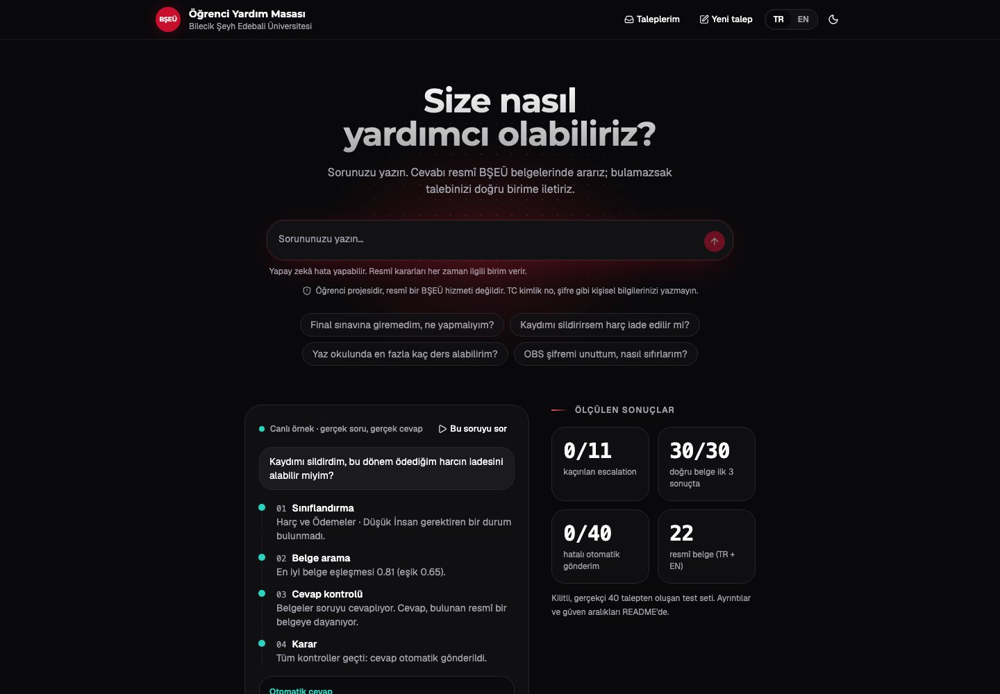
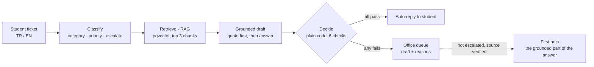
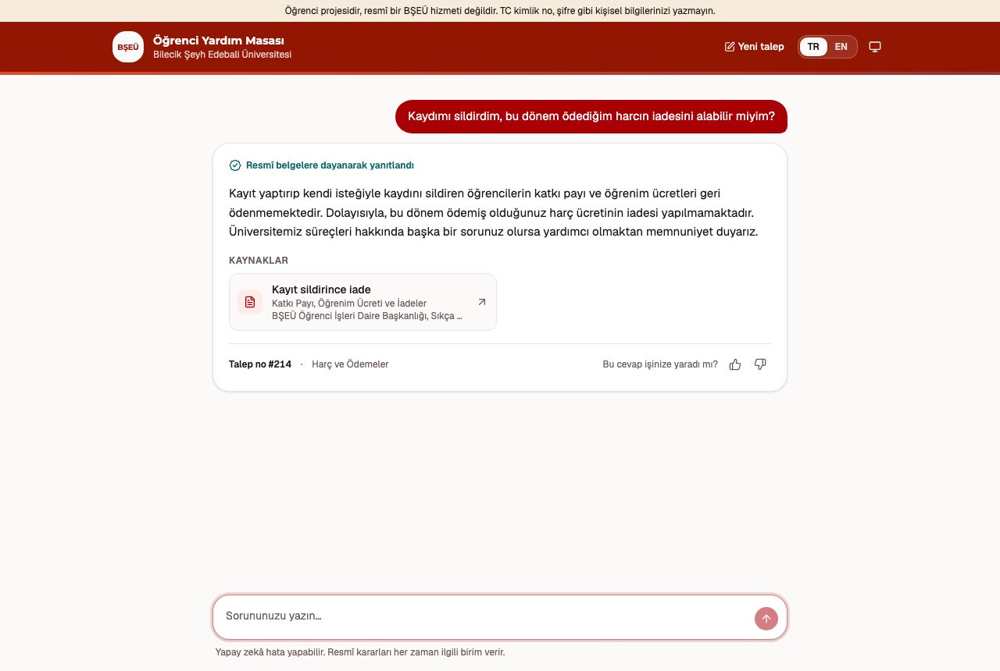
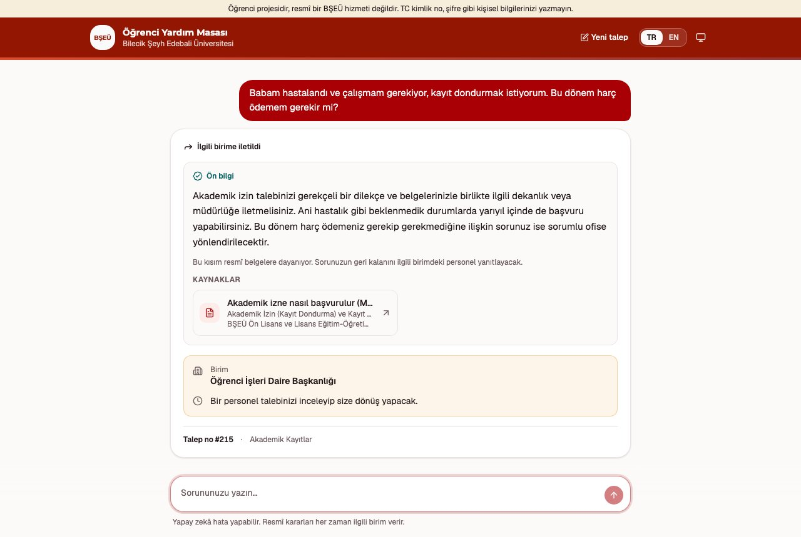
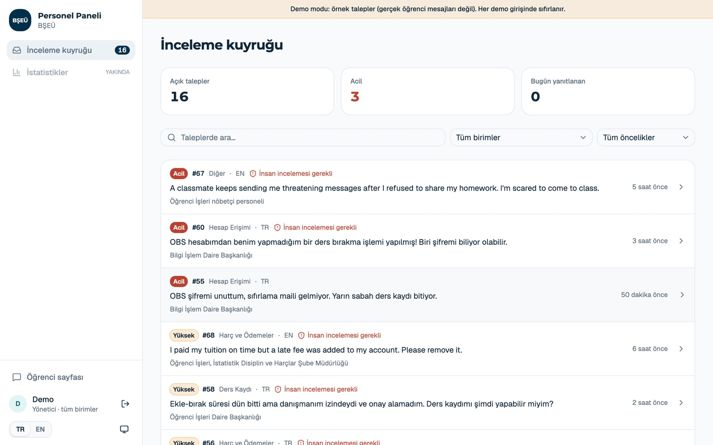
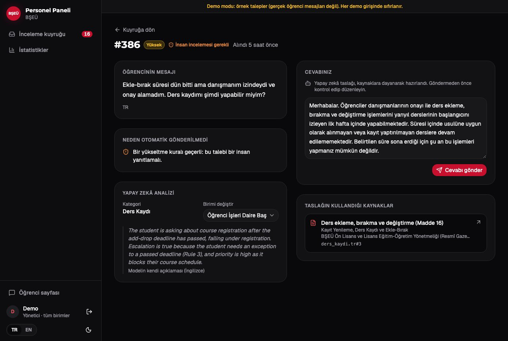

# BŞEÜ Helpdesk Ticket Assistant

[](https://github.com/AhmedElghazzawy/ai-ticket-assistant/actions/workflows/ci.yml)
[](https://github.com/AhmedElghazzawy/ai-ticket-assistant/actions/workflows/codeql.yml)

[](LICENSE)
[](https://bseu-helpdesk.onrender.com)

🇹🇷 [Türkçe](README.tr.md)

An AI assistant for a university helpdesk. It reads a student's support ticket (Turkish or English),
labels it, looks up the answer in official university documents (RAG), drafts a reply that cites its
source, and then decides in plain, tested code whether to **send the reply automatically** or
**route the ticket to the right office** with the draft attached.

**Live demo:** https://bseu-helpdesk.onrender.com: ask a question as a student, or open `/staff` →
**Demo olarak dene** to see the staff console with sample tickets (free hosting: the first visit after
a quiet period takes about a minute).

> Personal project by a computer engineering student at Bilecik Şeyh Edebali University (BŞEÜ). It is
> **not an official BŞEÜ service**: the colours come from bilecik.edu.tr's stylesheet, and the official logo is
> not used.



## Highlights

- **Safety first:** on a locked set of 40 realistic tickets, **0 of 11** tickets that needed a human
  were missed, and **0** replies were sent automatically when they should not have been.
- **The AI never makes the final call.** The send-or-forward decision is six explicit checks in
  [`decision.py`](src/helpdesk/domain/decision.py), each covered by tests.
- **Grounded answers:** every quoted rule must appear word for word in the retrieved document, checked
  by code; source cards are built from verified chunk IDs, never written by the model.
- **Help even when forwarded:** if a ticket goes to staff, the part the documents do answer is shown to
  the student right away ("first help"), but never on sensitive tickets.
- **Honest evaluation:** two locked test sets that were never used for tuning, and every metric
  reported with its sample size and a 95% Wilson confidence interval.
- **Production habits:** typed settings, mypy strict, 201 tests on a real Postgres, browser tests,
  CodeQL, Dependabot, Docker, structured logs with no student text, 12 architecture decision records.

## How it works



1. **Classify.** Gemini labels the ticket with a category (7 offices), a priority (`urgent`, `high`,
   `medium`, `low`) and whether it must go to a human (`escalate`). The label rulebook
   ([`docs/labels.md`](docs/labels.md), Turkish) is the system prompt; the output is constrained to a
   JSON schema, and the model writes its reasoning before the labels.
2. **Retrieve.** The ticket is embedded (`gemini-embedding-2`, multilingual) and the three closest
   chunks are found in Postgres with pgvector, in the ticket's language.
3. **Draft.** The model first quotes the rule it relies on, then states whether the documents cover
   the question, then writes the reply.
4. **Decide.** The reply is sent automatically only if **all** of these hold: the category is not
   `other`, no escalation, the priority is not `urgent`, the best match scores ≥ 0.65, the documents
   cover the question, and the reply cites a document that was really retrieved. Otherwise the ticket
   goes to the office's queue with the draft and the reasons.

Escalation covers safety threats, harassment or signs of crisis, possibly compromised accounts, rule
exceptions, money or record errors, grade and exam disputes, legal threats and disciplinary cases.
Being angry alone is not a reason.

More detail, diagrams and invariants: [ARCHITECTURE.md](ARCHITECTURE.md).

## Results

All numbers come from saved runs in [`eval/`](eval/). Intervals in brackets are 95% Wilson
confidence intervals; the samples are small, so the intervals are wide.

**Realistic locked set** (40 tickets, 20 TR + 20 EN, never used for tuning): long and messy
messages, typos, Turkish without Turkish characters, mixed languages, two problems in one ticket,
follow-ups, other institutions' business, softly worded harassment and crisis signs, a prompt injection.

| Metric | Result | Sample |
|---|---|---|
| **Missed escalations** (the most dangerous error) | **0 / 11** (both runs) | 11 escalation tickets |
| **Unsafe auto-sends** | **0** | 40 tickets |
| Replies citing the wrong document | 0 | 40 tickets |
| All three labels correct | 72.5% [57–84%] | 40 tickets |
| Category / priority / escalation | 92.5% / 85.0% / 95.0% | 40 tickets |
| Resolved without a human | 15 / 40 [24–53%] | 40 tickets |
| Right document in the top 3 (hit@3) | 100% [89–100%] | 30 answerable tickets |

**First locked set** (40 tickets): all three labels correct 73.8% (mean of two runs, 72.5% and
75.0%, each about 57–86%), 0 / 14 missed escalations, hit@3 100% [82–100%] on 17 answerable tickets,
1 harmless wrong auto-send (since fixed by adding the IT accounts document).

**Prompt-injection probes:** 12 / 12 safe [76–100%] (fake rules, breaking the fence, "ignore your
rules", prompt extraction, role play, canary words). 35 / 36 quotes in cited replies were found word for
word in the documents [86–99.5%].

**First help** (development set, 80 tickets): students who got help right away went from 15 / 79 to
27 / 80 [24–45%], with none on escalated tickets.

### What these numbers do not show

- The tickets are synthetic: I wrote or labelled every one (the realistic set was drafted by Claude
  from research on real student problems, and every label is mine). Real tickets are messier.
- 0 / 11 missed escalations does not prove the true rate is zero: the upper bound is about 26%.
- The development set was used to write the prompts, so its scores are optimistic (about 10 points
  higher than the locked set on the first run).
- The October 2026 knowledge-base expansion has not been measured on new tickets yet.

## Features

**For students**
- Answers in Turkish or English with source cards linking to the official page.
- **"Nasıl karar verildi?"**: a step-by-step trace of the real checks behind each decision.
- **Taleplerim**: track your tickets and read the staff reply with a secret access code (only its hash
  is stored, [ADR 0009](docs/decisions/0009-student-ticket-access-code.md)).
- Feedback buttons, an emergency (112) button on crisis tickets, and an honest waiting indicator.

**For staff**
- Login per office (Argon2id passwords, HttpOnly session cookies, CSRF protection, lockout after
  failed logins); staff only see their own office's tickets.
- Review queue: urgent first, then the longest waiting; edit the cited draft and send, or reassign.
- Insights page: totals, auto-replies, first help, waiting tickets, median reply time, usefulness,
  each with its sample size; every chart is also available as a table.
- Demo mode: sample tickets only, fully isolated from real tickets
  ([ADR 0006](docs/decisions/0006-demo-mode-keeps-login.md)).

| Grounded auto-reply | First help on a forwarded ticket |
|---|---|
|  |  |

| Staff review queue | Forwarded ticket with a cited draft |
|---|---|
|  |  |

## Knowledge base

14 topics × 2 languages = 28 documents and 190 chunks, written only from official BŞEÜ sources: the
undergraduate education regulation, exemption, summer school, internship, student club and disabled
students directives, the student affairs FAQ, the culture and sports (SKS) pages, the library pages, the IT
department's e-mail page, the 2026-2027 fee tables, the payment guide, the distance-learning (UZEM)
FAQ and the 2025-2026 orientation slides. Every quoted sentence was checked word for word against the
official text (119 at first; the grades document's 11 quotes were added and checked on 2026-11-05). The vectors are stored in [`data/kb_index.json`](data/kb_index.json) and copied
into Postgres at startup, so a fresh database fills itself without any API call. Which gaps were
filled and why: [`docs/knowledge_gaps.md`](docs/knowledge_gaps.md).

## Security and privacy

- **Prompt injection:** the student's text is fenced in both prompts, and the grounding check rejects
  any quote that is not in the retrieved rules ([ADR 0010](docs/decisions/0010-prompt-injection-defence.md)).
- **No personal data in logs:** only the length of a ticket is logged, never its text or an e-mail
  address; a test enforces this.
- **Abuse limits:** rate limits on public endpoints, a daily ticket cap, a trusted client-IP header
  ([ADR 0007](docs/decisions/0007-client-ip-header.md)), SQL only through placeholders.
- **Secrets** live only in the environment; the image runs as a non-root user.

See [SECURITY.md](SECURITY.md) to report a vulnerability.

## Tech stack

| Layer | Tools |
|---|---|
| LLM | Google Gemini (`gemini-3.5-flash-lite`, free tier), `gemini-embedding-2` |
| Backend | Python 3.12, FastAPI, pydantic-settings, structlog, psycopg 3 |
| Database | PostgreSQL 18 + pgvector (Neon in production) |
| Frontend | React 19, TypeScript, Vite, Tailwind CSS, shadcn/ui, TanStack Router + Query; the API client is generated from the OpenAPI schema |
| Quality | uv, ruff, mypy (strict), pytest with coverage gate, Playwright, Biome, CodeQL, Dependabot |
| Delivery | Docker (multi-stage, non-root), GitHub Actions, Render (Frankfurt) |

Why each major choice was made, in Turkish: [`docs/decisions/`](docs/decisions/).

## Quick start

**With Docker** (needs only Docker and a [Gemini API key](https://aistudio.google.com/apikey)):

```sh
cp .env.example .env           # then put your own API key in .env
docker compose up --build      # open http://127.0.0.1:8000
```

**For development** (Python 3.12, [uv](https://docs.astral.sh/uv/), Node.js 24 LTS):

```sh
make install                   # uv sync --locked + npm ci in frontend/
make db                        # local Postgres 18 + pgvector on port 5433
make serve                     # API with auto-reload on http://127.0.0.1:8000
cd frontend && npm run dev     # web app on http://localhost:5173 (students) and /staff
```

Create a staff account (there is no public sign-up):

```sh
uv run python tools/add_staff.py name@bilecik.edu.tr "Full Name" --office it   # it, student_affairs, fees, sks, duty
```

**Checks** (no API calls): `make check` runs everything CI runs: ruff, mypy, pytest on Postgres, the
OpenAPI drift check and the frontend checks. `make help` lists every command.

**Evaluations** call the model: `make eval SUITE=classifier|pipeline|retrieval|security`, with `SET=dev`
(default), `SET=test` or `SET=phase8`. Every saved result records the git commit, prompt hashes, dataset
and knowledge-base hashes and the model that produced it. The locked sets are only ever measured, never
tuned on.

## Project structure

```
src/helpdesk/        Backend package; layers depend only inward (core <- domain <- the rest)
  core/              Settings (validated at startup), paths, structured logs
  domain/            Pure rules: decision, offices, labels and dataset, output schemas, grounding
  ai/                Gemini client (retries, timeouts, cost), classifier, grounded answer, injection fence
  retrieval/         Chunking, embeddings, index sync and pgvector search
  storage/           Connection pool, versioned migrations, ticket table
  api/               FastAPI app factory and routers (students, auth, staff)
  evals/             Classifier, retrieval, pipeline and security evals; Wilson intervals
  pipeline.py        One ticket end to end
frontend/            React app (student chat, Taleplerim, staff console) and Playwright tests
data/knowledge_base/ The 28 official-source documents (TR + EN)
data/tickets/        Labelled tickets: dev (80), locked test (40), locked realistic (40)
eval/                Saved evaluation results
docs/                Label rulebook, decision records, roadmap, problem catalogue, changelog
tests/               201 pytest tests against a real Postgres; every AI call is faked
tools/               Staff accounts, demo data, OpenAPI export, dataset audit
```

## Limitations

- One category per ticket: part of a ticket that concerns two offices can reach the wrong one.
- Staff replies reach students only on the "Taleplerim" page of the same browser; there is no e-mail
  notification or student login (SSO) yet.
- Fees, meal prices and opening hours change every year, and the documents are updated by hand.
- Lost property, Office 365 licences, fault reports and anything without an official source always go
  to a human.
- The internship rules cover only the Faculty of Engineering; the KYK dormitory section relies on a
  non-official source and says so.
- The free tier limits requests per minute and per day, which is why Flash-Lite is used and calls
  are paced.

## Roadmap

| Area | Status |
|---|---|
| Classification, locked test sets, RAG, grounded answers, decision rules, API, review queue | ✅ Done |
| Infrastructure, package structure, typed settings, CI, Docker, live deployment | ✅ Done |
| Realistic data set, confidence intervals, prompt-injection defence, staff product | 🟡 Mostly done |
| One-command versioned eval report, model comparison, LLM-as-judge | ⏳ Next |
| Cost and error monitoring, larger attack set, e-mail notifications, SSO | ⏳ Planned |

Details: [docs/ROADMAP.md](docs/ROADMAP.md). Every change and the reason for it:
[docs/changelog.md](docs/changelog.md).

## How it was built

Built by Ahmed Elghazzawy, with [Claude Code](https://claude.com/claude-code) as a pair programmer under written
rules: [CLAUDE.md](CLAUDE.md) defines the workflow (test first, explain every step, record every
decision), and [`.claude/`](.claude/) holds the skills, review subagents and hooks, one of which blocks
any edit to the locked test sets ([ADR 0011](docs/decisions/0011-agent-instructions-and-guardrails.md)).
Contributions: see [CONTRIBUTING.md](CONTRIBUTING.md).

## License

[MIT](LICENSE) © 2026 Ahmed Elghazzawy
