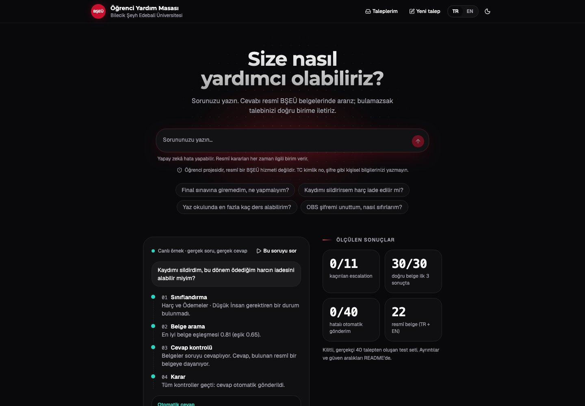
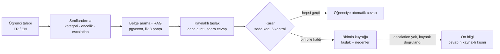
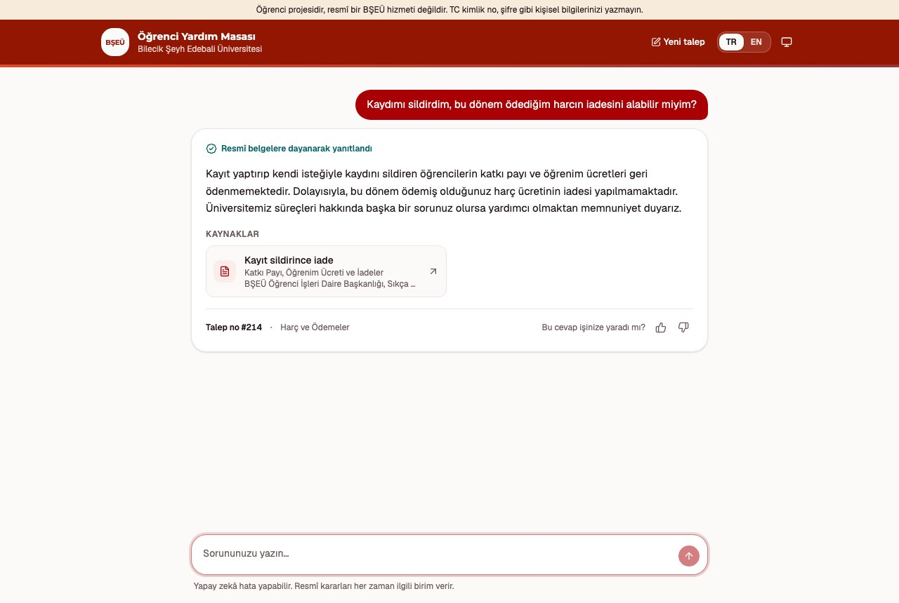
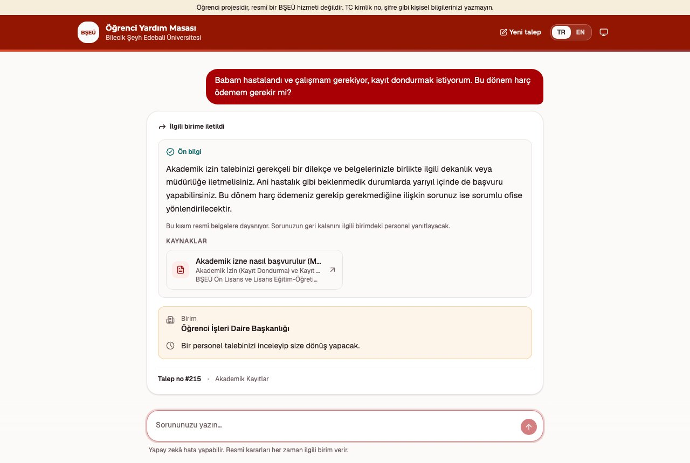
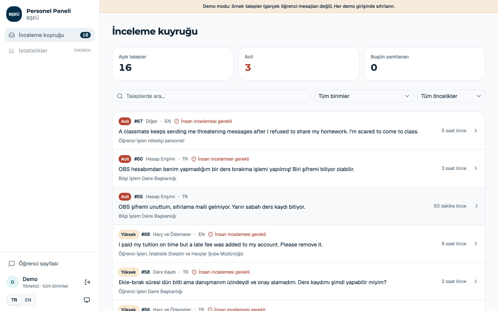
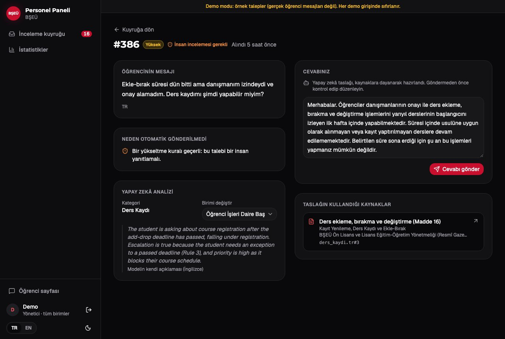

# BŞEÜ Yardım Masası Ticket Asistanı

[](https://github.com/AhmedElghazzawy/ai-ticket-assistant/actions/workflows/ci.yml)
[](https://github.com/AhmedElghazzawy/ai-ticket-assistant/actions/workflows/codeql.yml)

[](LICENSE)
[](https://bseu-helpdesk.onrender.com)

🇬🇧 [English](README.md)

Üniversite yardım masası için bir AI asistanı. Öğrencinin yazdığı talebi (ticket, Türkçe veya
İngilizce) okur, etiketler, cevabı üniversitenin resmî belgelerinde arar (RAG), kaynağını gösteren bir
taslak cevap yazar ve ardından sade, testli kodla karar verir: cevabı **otomatik göndermek** mi, yoksa
talebi taslakla birlikte **doğru birime yönlendirmek** mi.

**Canlı demo:** https://bseu-helpdesk.onrender.com: öğrenci olarak bir soru yazın veya `/staff` →
**Demo olarak dene** ile personel panelini örnek taleplerle açın (ücretsiz sunucu: bir süre ziyaretçi
olmazsa ilk açılış yaklaşık 1 dakika sürer).

> Bilecik Şeyh Edebali Üniversitesi (BŞEÜ) Bilgisayar Mühendisliği öğrencisinin kişisel projesidir;
> **BŞEÜ'nün resmî bir hizmeti değildir.** Renkler bilecik.edu.tr'nin stil dosyasından alınmıştır,
> resmî logo kullanılmaz.



## Öne çıkanlar

- **Önce güvenlik:** 40 gerçekçi talepten oluşan kilitli sette, insana gitmesi gereken **11 talepten
  hiçbiri kaçırılmadı** ve gönderilmemesi gereken **hiçbir cevap otomatik gönderilmedi**.
- **Son kararı yapay zekâ vermez.** Gönder / yönlendir kararı [`decision.py`](src/helpdesk/domain/decision.py)
  içinde altı açık kontroldür ve her biri testlidir.
- **Kaynaklı cevaplar:** alıntılanan her kural, bulunan belgede kodla **birebir** aranır; kaynak kartları
  model tarafından yazılmaz, doğrulanmış parça (chunk) kimliklerinden kodla oluşturulur.
- **Yönlendirilen talepte de yardım:** talep personele gitse bile belgelerin cevapladığı kısım öğrenciye
  hemen "ön bilgi" olarak gösterilir; hassas taleplerde asla.
- **Dürüst değerlendirme:** ayar için hiç kullanılmayan iki kilitli test seti; her ölçüt örnek sayısı ve
  %95 Wilson güven aralığıyla.
- **Üretim alışkanlıkları:** tipli ayarlar, mypy strict, gerçek Postgres üzerinde 201 test, tarayıcı
  testleri, CodeQL, Dependabot, Docker, öğrenci metni içermeyen yapılandırılmış loglar, 12 karar kaydı (ADR).

## Nasıl çalışır



1. **Sınıflandırma.** Gemini talebe bir kategori (7 birim), bir öncelik (`urgent`, `high`, `medium`,
   `low`) ve insana gidip gitmeyeceğini (`escalate`) verir. Etiket kural kitabı
   ([`docs/labels.md`](docs/labels.md)) system prompt'tur; çıktı bir JSON şemasıyla sınırlıdır ve model
   etiketlerden önce gerekçesini yazar.
2. **Belge arama.** Talebin embedding'i çıkarılır (`gemini-embedding-2`, çok dilli) ve en yakın üç parça
   Postgres'te pgvector ile, talebin dilinde bulunur.
3. **Taslak.** Model önce dayandığı kuralı aynen alıntılar, sonra belgelerin soruyu cevaplayıp
   cevaplamadığını söyler, sonra cevabı yazar.
4. **Karar.** Cevap yalnızca şunların **hepsi** sağlanırsa otomatik gönderilir: kategori `other` değil,
   escalation yok, öncelik `urgent` değil, en iyi eşleşme ≥ 0,65, belgeler soruyu cevaplıyor ve cevap
   gerçekten bulunan bir belgeyi kaynak gösteriyor. Aksi hâlde talep, taslak ve nedenlerle birlikte
   birimin kuyruğuna gider.

Escalation şunları kapsar: güvenlik tehdidi, taciz veya kriz belirtisi, ele geçirilmiş olabilecek hesap,
kural istisnası, para veya resmî kayıt hatası, not ve sınav itirazı, hukuki tehdit ve disiplin süreci.
Sadece sinirli olmak bir neden değildir.

Ayrıntılar, diyagramlar ve değişmez kurallar: [ARCHITECTURE.md](ARCHITECTURE.md) (İngilizce).

## Sonuçlar

Bütün sayılar [`eval/`](eval/) klasöründeki kayıtlı çalıştırmalardan gelir. Köşeli parantezler %95
Wilson güven aralığıdır; örnekler küçük olduğu için aralıklar geniştir.

**Gerçekçi kilitli set** (40 talep, 20 TR + 20 EN, ayar için hiç kullanılmadı): uzun ve dağınık
mesajlar, yazım hataları, Türkçe karakter kullanılmayan metinler, karışık dil, iki sorunlu talepler, takip
mesajları, başka kurumların işi, hafifçe yazılmış taciz ve kriz belirtileri, bir prompt injection.

| Ölçüt | Sonuç | Örnek |
|---|---|---|
| **Kaçırılan escalation** (en tehlikeli hata) | **0 / 11** (iki çalıştırmada da) | 11 escalation talebi |
| **Hatalı otomatik gönderim** | **0** | 40 talep |
| Yanlış belge gösteren cevap | 0 | 40 talep |
| Üç etiketin üçü de doğru | %72,5 [%57–84] | 40 talep |
| Kategori / öncelik / escalation | %92,5 / %85,0 / %95,0 | 40 talep |
| İnsansız çözülen | 15 / 40 [%24–53] | 40 talep |
| Doğru belge ilk 3 sonuçta (hit@3) | %100 [%89–100] | cevaplanabilir 30 talep |

**İlk kilitli set** (40 talep): üç etiketin üçü de doğru %73,8 (iki çalıştırmanın ortalaması, %72,5 ve
%75,0; her biri yaklaşık %57–86), kaçırılan escalation 0 / 14, cevaplanabilir 17 talepte hit@3 %100
[%82–100], 1 zararsız hatalı otomatik gönderim (Bilişim Hesapları belgesi eklenerek kapatıldı).

**Prompt injection denemeleri:** 12 / 12 güvenli [%76–100] (sahte kural, çiti kırma, "kurallarını unut",
talimatları yazdırma, rol yapma, kanarya kelimesi). Kaynak gösteren cevaplardaki alıntıların 35 / 36'sı
belgelerde birebir bulundu [%86–99,5].

**Ön bilgi** (dev seti, 80 talep): hemen yardım alan öğrenci 15 / 79'dan 27 / 80'e çıktı [%24–45];
escalation gerektiren hiçbir talepte gösterilmedi.

### Bu sayılar neyi göstermez

- Talepler sentetiktir: hepsini ben yazdım veya etiketledim (gerçekçi seti, gerçek öğrenci sorunları
  üzerine yapılan araştırmadan Claude taslak olarak yazdı; etiketlerin hepsi benim). Gerçek talepler daha
  dağınıktır.
- 0 / 11 kaçırılan escalation, gerçek oranın sıfır olduğunu kanıtlamaz: üst sınır yaklaşık %26'dır.
- Prompt'lar dev setiyle yazıldı, bu yüzden dev skorları iyimserdir (ilk çalıştırmada kilitli setten
  yaklaşık 10 puan yüksek).
- Ekim 2026 bilgi tabanı genişletmesi henüz yeni taleplerle ölçülmedi.

## Özellikler

**Öğrenciler için**
- Türkçe veya İngilizce cevap ve resmî sayfaya bağlanan kaynak kartları.
- **"Nasıl karar verildi?"**: kararın arkasındaki gerçek kontrollerin adım adım izi.
- **Taleplerim**: gizli bir erişim koduyla talebi takip etme ve personelin cevabını okuma (veritabanında
  yalnızca kodun özeti saklanır, [ADR 0009](docs/decisions/0009-student-ticket-access-code.md)).
- Geri bildirim düğmeleri, kriz taleplerinde acil durum (112) düğmesi ve dürüst bir bekleme göstergesi.

**Personel için**
- Birime göre giriş (Argon2id şifreler, HttpOnly oturum çerezi, CSRF koruması, hatalı girişlerde
  engelleme); personel yalnızca kendi biriminin taleplerini görür.
- İnceleme kuyruğu: önce acil olanlar, sonra en uzun bekleyen; kaynaklı taslağı düzenleyip gönderme veya
  birim değiştirme.
- İstatistikler: toplam, otomatik cevap, ön bilgi, bekleyen, medyan cevap süresi, faydalı bulunma;
  her biri örnek sayısıyla; her grafik tablo olarak da görülebilir.
- Demo modu: yalnızca örnek talepler, gerçek taleplerden tamamen ayrı
  ([ADR 0006](docs/decisions/0006-demo-mode-keeps-login.md)).

| Kaynaklı otomatik cevap | Yönlendirilen talepte ön bilgi |
|---|---|
|  |  |

| Personel inceleme kuyruğu | Kaynaklı taslakla yönlendirilen talep |
|---|---|
|  |  |

## Bilgi tabanı

14 konu × 2 dil = 28 belge ve 190 parça, yalnızca resmî BŞEÜ kaynaklarından: Ön Lisans ve Lisans
Eğitim-Öğretim Yönetmeliği, Muafiyet ve İntibak, Yaz Okulu, Staj, Öğrenci Kulüpleri ve Engelli
Öğrenciler yönergeleri, Öğrenci İşleri SSS, SKS sayfaları, Kütüphane sayfaları, Bilgi İşlem e-posta
sayfası, 2026-2027 katkı payı tabloları, Tahsilat Rehberi, UZEM SSS ve 2025-2026 oryantasyon
sunumları. Tırnak içindeki her cümle resmî metinle birebir kontrol edildi (önce 119; notlar belgesinin 11 alıntısı 2026-11-05'te eklenip kontrol edildi). Vektörler
[`data/kb_index.json`](data/kb_index.json) dosyasında saklanır ve uygulama başlarken Postgres'e
kopyalanır; böylece boş bir veritabanı API çağrısı yapmadan dolar. Hangi boşluğun neden kapatıldığı:
[`docs/knowledge_gaps.md`](docs/knowledge_gaps.md).

## Güvenlik ve kişisel veri

- **Prompt injection:** öğrencinin metni her iki prompt'ta çitle ayrılır ve alıntı kontrolü, bulunan
  kurallarda olmayan her alıntıyı reddeder ([ADR 0010](docs/decisions/0010-prompt-injection-defence.md)).
- **Loglarda kişisel veri yok:** bir talebin yalnızca uzunluğu loglanır, metni veya e-posta adresi asla;
  bunu bir test garanti eder.
- **Kötüye kullanım sınırları:** herkese açık uç noktalarda rate limit, günlük talep sınırı, güvenilir
  istemci IP başlığı ([ADR 0007](docs/decisions/0007-client-ip-header.md)), SQL yalnızca yer tutucularla.
- **Gizli bilgiler** yalnızca ortam değişkenlerindedir; imaj root olmayan bir kullanıcıyla çalışır.

Güvenlik açığı bildirmek için: [SECURITY.md](SECURITY.md).

## Teknolojiler

| Katman | Araçlar |
|---|---|
| LLM | Google Gemini (`gemini-3.5-flash-lite`, ücretsiz katman), `gemini-embedding-2` |
| Backend | Python 3.12, FastAPI, pydantic-settings, structlog, psycopg 3 |
| Veritabanı | PostgreSQL 18 + pgvector (üretimde Neon) |
| Frontend | React 19, TypeScript, Vite, Tailwind CSS, shadcn/ui, TanStack Router + Query; API istemcisi OpenAPI şemasından üretilir |
| Kalite | uv, ruff, mypy (strict), kapsam eşikli pytest, Playwright, Biome, CodeQL, Dependabot |
| Dağıtım | Docker (çok aşamalı, root olmayan), GitHub Actions, Render (Frankfurt) |

Her önemli seçimin nedeni: [`docs/decisions/`](docs/decisions/).

## Hızlı başlangıç

**Docker ile** (yalnızca Docker ve bir [Gemini API anahtarı](https://aistudio.google.com/apikey) gerekir):

```sh
cp .env.example .env           # sonra .env içine kendi API anahtarınızı yazın
docker compose up --build      # http://127.0.0.1:8000 adresini açın
```

**Geliştirme için** (Python 3.12, [uv](https://docs.astral.sh/uv/), Node.js 24 LTS):

```sh
make install                   # uv sync --locked + frontend/ içinde npm ci
make db                        # yerel Postgres 18 + pgvector, port 5433
make serve                     # otomatik yenilenen API: http://127.0.0.1:8000
cd frontend && npm run dev     # web arayüzü: http://localhost:5173 (öğrenci) ve /staff
```

Personel hesabı oluşturma (herkese açık kayıt yoktur):

```sh
uv run python tools/add_staff.py ad@bilecik.edu.tr "Ad Soyad" --office it   # it, student_affairs, fees, sks, duty
```

**Kontroller** (API çağrısı yok): `make check`, CI'daki her şeyi çalıştırır: ruff, mypy, Postgres
üzerinde pytest, OpenAPI uyumu ve frontend kontrolleri. `make help` tüm komutları listeler.

**Değerlendirmeler** modeli çağırır: `make eval SUITE=classifier|pipeline|retrieval|security`; `SET=dev`
(varsayılan), `SET=test` veya `SET=phase8` ile. Kayıtlı her sonuç, onu üreten git commit'ini, prompt
hash'lerini, veri seti ve bilgi tabanı hash'lerini ve modeli içerir. Kilitli setlerde yalnızca ölçülür,
asla ayar yapılmaz.

## Proje yapısı

```
src/helpdesk/        Backend paketi; katmanlar yalnızca içe doğru bağımlıdır (core <- domain <- diğerleri)
  core/              Ayarlar (başlangıçta doğrulanır), dosya yolları, yapılandırılmış loglar
  domain/            Saf kurallar: karar, birimler, etiketler ve veri seti, çıktı şemaları, alıntı kontrolü
  ai/                Gemini istemcisi (retry, timeout, maliyet), sınıflandırıcı, kaynaklı cevap, injection çiti
  retrieval/         Parçalara bölme, embedding, index senkronu ve pgvector araması
  storage/           Bağlantı havuzu, sürümlü migration'lar, talep tablosu
  api/               FastAPI uygulama fabrikası ve router'lar (öğrenci, giriş, personel)
  evals/             Sınıflandırma, arama, tüm akış ve güvenlik değerlendirmeleri; Wilson aralıkları
  pipeline.py        Bir talep için baştan sona akış
frontend/            React uygulaması (öğrenci sohbeti, Taleplerim, personel paneli) ve Playwright testleri
data/knowledge_base/ Resmî kaynaklı 28 belge (TR + EN)
data/tickets/        Etiketli talepler: dev (80), kilitli test (40), kilitli gerçekçi set (40)
eval/                Kayıtlı değerlendirme sonuçları
docs/                Etiket kural kitabı, karar kayıtları, yol haritası, sorun kataloğu, değişiklik günlüğü
tests/               Gerçek Postgres üzerinde 201 pytest testi; her AI çağrısı taklit edilir
tools/               Personel hesapları, demo verisi, OpenAPI dışa aktarma, veri seti denetimi
```

## Sınırlar

- Her talep tek bir kategori alır: iki birimi ilgilendiren bir talebin bir kısmı yanlış birime gidebilir.
- Personelin cevabı öğrenciye yalnızca aynı tarayıcıdaki "Taleplerim" sayfasında ulaşır; e-posta
  bildirimi ve öğrenci girişi (SSO) henüz yoktur.
- Ücretler, yemek fiyatları ve çalışma saatleri her yıl değişir; belgeler elle güncellenir.
- Kayıp eşya, Office 365 lisansı, arıza bildirimleri ve resmî kaynağı olmayan her konu insana gider.
- Staj kuralları yalnızca Mühendislik Fakültesi içindir; KYK yurt bölümü resmî olmayan bir kaynağa
  dayanır ve bunu belirtir.
- Ücretsiz katmanın dakika ve gün başına istek sınırları vardır; bu yüzden Flash-Lite kullanılır ve
  çağrılar arasında beklenir.

## Yol haritası

| Alan | Durum |
|---|---|
| Sınıflandırma, kilitli test setleri, RAG, kaynaklı cevap, karar kuralları, API, inceleme kuyruğu | ✅ Tamamlandı |
| Altyapı, paket yapısı, tipli ayarlar, CI, Docker, canlıya alma | ✅ Tamamlandı |
| Gerçekçi veri seti, güven aralıkları, prompt injection savunması, personel ürünü | 🟡 Büyük ölçüde |
| Tek komutla sürümlü değerlendirme raporu, model karşılaştırması, LLM-as-judge | ⏳ Sırada |
| Maliyet ve hata izleme, daha büyük saldırı seti, e-posta bildirimi, SSO | ⏳ Planlandı |

Ayrıntılar: [docs/ROADMAP.md](docs/ROADMAP.md). Her değişiklik ve nedeni:
[docs/changelog.md](docs/changelog.md) (İngilizce).

## Nasıl geliştirildi

Ahmed Elghazzawy tarafından, yazılı kurallar altında eşli programcı olarak
[Claude Code](https://claude.com/claude-code) ile geliştirildi: [CLAUDE.md](CLAUDE.md) çalışma şeklini
tanımlar (önce test, her adımı açıklama, her kararı kaydetme); [`.claude/`](.claude/) klasöründe
skill'ler, inceleme ajanları ve kilitli test setlerinde her değişikliği engelleyen bir hook bulunur
([ADR 0011](docs/decisions/0011-agent-instructions-and-guardrails.md)). Katkı için:
[CONTRIBUTING.md](CONTRIBUTING.md).

## Lisans

[MIT](LICENSE) © 2026 Ahmed Elghazzawy
